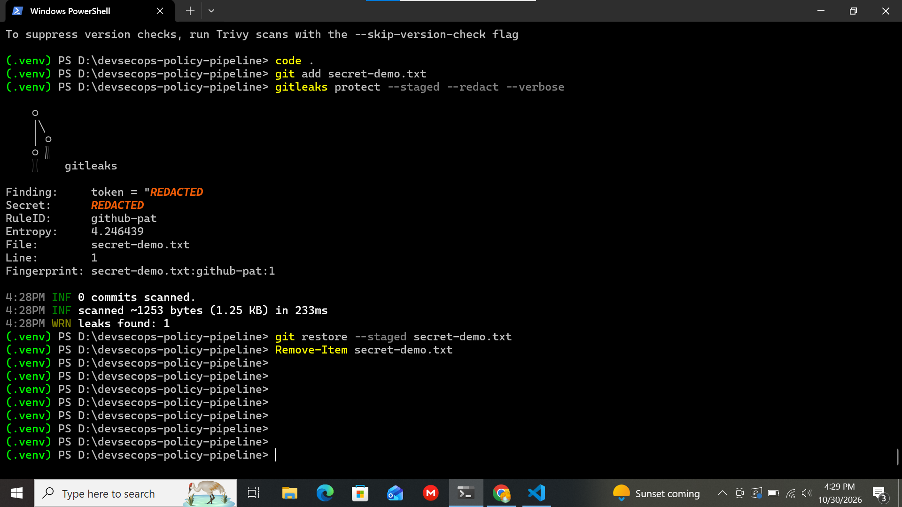
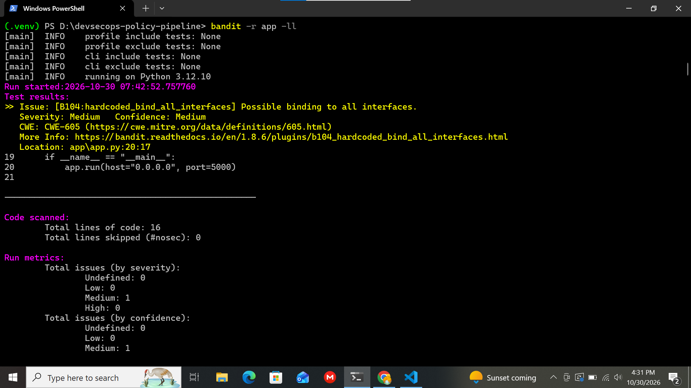
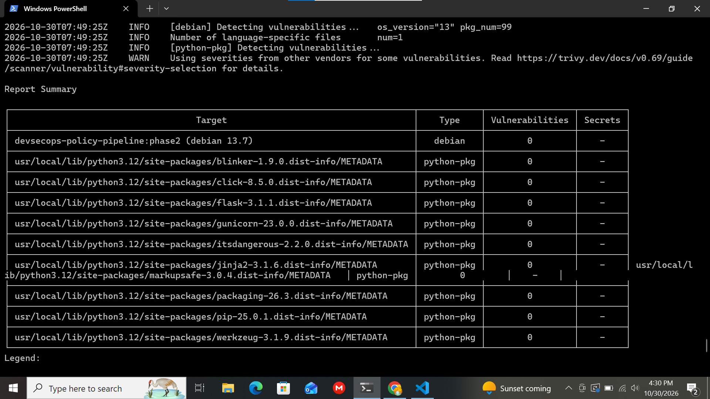
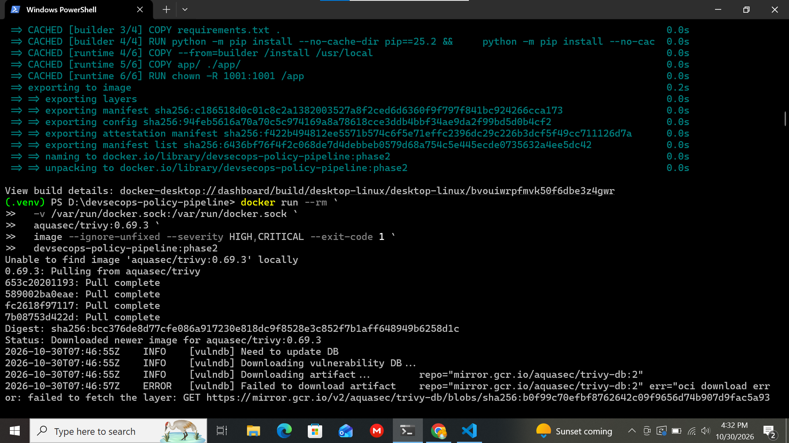
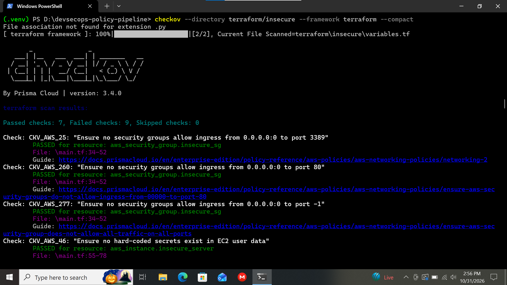
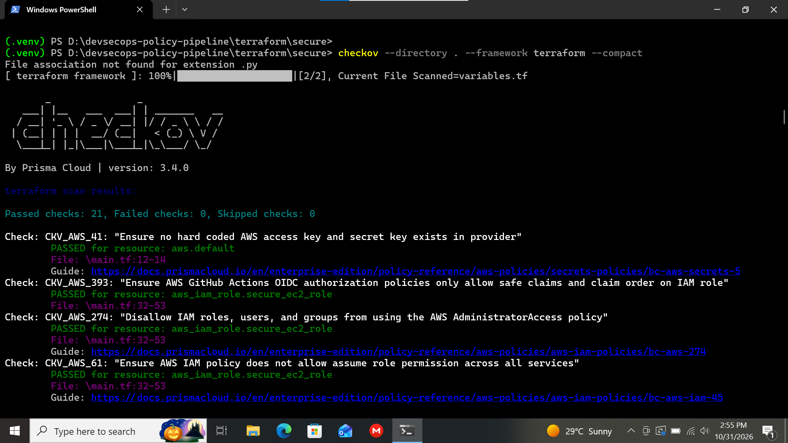
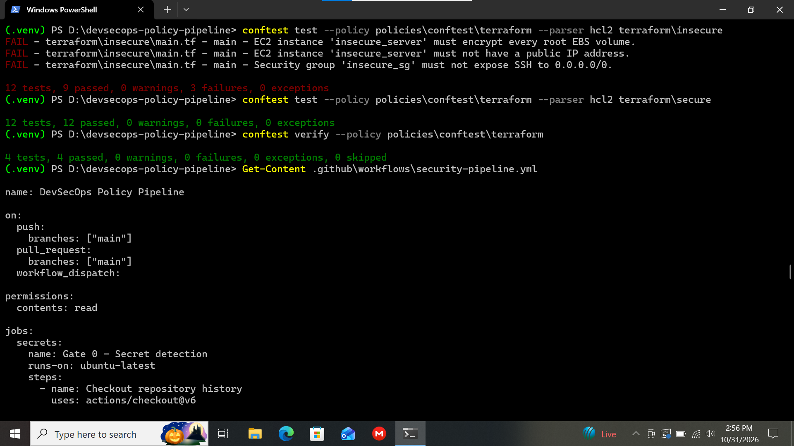
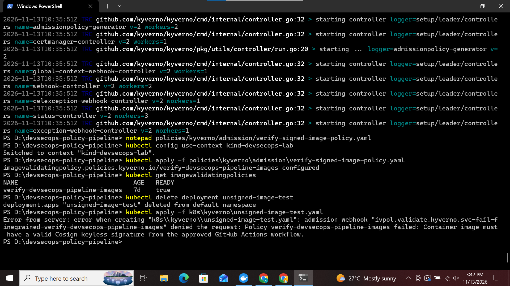

# DevSecOps Policy-as-Code Pipeline
 


 
A hands-on DevSecOps project that shifts security left in CI and enforces it again at deployment time. Insecure code, infrastructure, containers, and Kubernetes workloads are designed to fail before they ever reach a running environment.
 
The project combines secret scanning, SAST and dependency checks, Dockerfile and image scanning, Terraform policy-as-code, Kubernetes policy-as-code, Kyverno admission control, and a signed software supply chain (Cosign keyless signing plus a CycloneDX SBOM).
 
## Table of contents
 
- [Goals](#goals)
- [Architecture](#architecture)
- [Security gates](#security-gates)
- [Demo and evidence](#demo-and-evidence)
- [Tech stack](#tech-stack)
- [Repository layout](#repository-layout)
- [Running checks locally](#running-checks-locally)
- [Registry and signing configuration](#registry-and-signing-configuration)
- [Testing approach](#testing-approach)
- [Repository hygiene](#repository-hygiene)
- [Limitations](#limitations)
- [Author](#author)
## Goals
 
- Detect exposed secrets before code is merged.
- Find source-code and dependency vulnerabilities.
- Enforce Dockerfile security and quality rules.
- Scan container images for known vulnerabilities.
- Validate Terraform with static analysis and custom Rego policies.
- Enforce Kubernetes workload hardening requirements.
- Block unsigned or untrusted images at cluster admission.
- Publish a signed image with an attached CycloneDX SBOM.
- Prove the controls work with both passing and intentionally failing tests.
## Architecture

```mermaid
flowchart LR
    A[Push or Pull Request to main] --> G0[Gate 0: Gitleaks]
    G0 --> G1[Gate 1: Bandit, pip-audit, pytest]
    G1 --> G2[Gate 2: Hadolint]
    G2 --> G3[Gate 3: Trivy image scan]
    G3 --> G4[Gate 4: Checkov and Conftest on Terraform]
    G4 --> G5[Gate 5: Conftest on Kubernetes manifests]
    G5 --> G7[Gate 7: Build, push, SBOM, Cosign sign]
    G7 --> R[(GHCR image + signature + SBOM attestation)]
    R --> G6[Gate 6: Kyverno admission control]
    G6 --> K[Kind cluster]
```
 

 
The CI gates run in GitHub Actions. Kyverno is the second line of defense: even if something bypasses CI, the cluster refuses workloads that violate policy or use unverified images.
 
## Security gates
 
The workflow lives in `.github/workflows/security-pipeline.yml`. It runs on pushes and pull requests to `main` and can be started manually with `workflow_dispatch`.
 
| Gate | Purpose | Tools |
|------|---------|-------|
| 0. Secret detection | Fail on committed credentials, tokens, and keys | Gitleaks |
| 1. Code and dependencies | Python SAST, vulnerable dependencies, unit tests | Bandit, pip-audit, pytest |
| 2. Dockerfile | Lint and security best practices | Hadolint |
| 3. Container image | Known vulnerabilities at HIGH and CRITICAL severity | Trivy |
| 4. Terraform | Static analysis plus custom policies (public exposure, open SSH, unencrypted EBS) | Checkov, Conftest, OPA |
| 5. Kubernetes manifests | Non-root, dropped capabilities, seccomp, no unnecessary service-account token | Conftest, OPA, Rego |
| 6. Admission control | Enforce workload rules and image verification inside the cluster | Kyverno |
| 7. Supply chain | Build, publish, scan, SBOM, sign, attest, verify | Buildx, GHCR, Trivy, Anchore SBOM Action, Cosign, CycloneDX |
 
### Gate details
 
**Gate 0 - Secrets.** Gitleaks scans the repository for credentials and secret patterns. Any finding fails the job.
 
**Gate 1 - Code and dependencies.** Bandit checks Python source for common security issues, pip-audit checks dependencies against known advisories, and pytest runs the application tests. The app is a Flask service served by Gunicorn on port `5000`.
 
**Gate 2 - Dockerfile.** Hadolint checks for insecure or low-quality patterns. The image runs as a non-root user and installs dependencies explicitly.
 
**Gate 3 - Image scan.** Trivy scans the built image and fails the job at the configured severity threshold.
 
**Gate 4 - Terraform.** The repo contains two examples, `terraform/secure` (compliant) and `terraform/insecure` (deliberately non-compliant). Checkov and Conftest must pass the secure example and flag the insecure one.
 
**Gate 5 - Kubernetes policy.** Rego policies in `policies/conftest/kubernetes` validate manifests before deployment. A secure manifest passes, and the manifests in `k8s/bad-deployments` are expected to be rejected.
 
**Gate 6 - Admission control.** Kyverno policies under `policies/kyverno` enforce secure workload requirements and verify images from the project's GHCR repository. Image verification trusts Sigstore keyless signatures produced by this repository's workflow and requires a signed CycloneDX SBOM attestation. An intentionally unsigned image (`Dockerfile.unsigned-test`) is used as a negative test and must be denied.
 
**Gate 7 - Supply chain.** The workflow builds and publishes the image to GHCR, scans it, generates a CycloneDX SBOM, signs the image with Cosign using GitHub Actions OIDC (no long-lived keys), attaches the SBOM attestation, and verifies both against the expected workflow identity. Images should always be referenced by immutable digest, not by tag.
 
## Demo and evidence
 
Each screenshot below is real output from a local or CI run of the corresponding gate.
 
### Gate 0: Secret detection (Gitleaks)
 

### Gate 1: Python source security (Bandit)
 

### Gate 3: Container image security (Trivy)
 


### Gate 4: Terraform security (Checkov)
 
The insecure example is expected to fail:
 

The secure example is expected to pass:
 

### Gate 5: Kubernetes policy-as-code (Conftest)
 

### Gate 6: Admission control (Kyverno)
 

## Tech stack
 
| Area | Tools |
|------|-------|
| CI/CD | GitHub Actions |
| Source security | Gitleaks, Bandit |
| Dependency security | pip-audit |
| Testing | pytest |
| Dockerfile linting | Hadolint |
| Container security | Docker, Trivy |
| Infrastructure as Code | Terraform (AWS provider) |
| IaC security | Checkov |
| Policy as code | Open Policy Agent, Conftest, Rego |
| Kubernetes | Kubernetes, Kind, kubectl |
| Admission control | Kyverno |
| Registry | GitHub Container Registry |
| SBOM | CycloneDX, Anchore SBOM Action |
| Signing | Sigstore Cosign, GitHub Actions OIDC |
 
## Repository layout
 
```
devsecops-policy-pipeline/
├── .github/workflows/        # security-pipeline.yml
├── app/                      # Flask application
├── docs/                     # Policy enforcement and admission control notes
├── k8s/
│   ├── bad-deployments/      # Intentionally insecure manifests (negative tests)
│   └── kyverno/              # Admission test workloads
├── policies/
│   ├── conftest/             # Rego policies for Kubernetes and Terraform
│   └── kyverno/              # Kyverno admission and image verification policies
├── screenshots/              # Evidence used in this README
├── scripts/                  # Helper scripts
├── terraform/
│   ├── secure/               # Compliant example
│   └── insecure/             # Intentionally non-compliant example
├── tests/                    # pytest suite
├── Dockerfile
├── Dockerfile.unsigned-test  # Used for the unsigned image negative test
├── requirements.txt
├── requirements-dev.txt
└── requirements-security.txt
```
 
## Running checks locally
 
Run everything from the repository root.
 
**Python**
 
```bash
pip install -r requirements.txt -r requirements-dev.txt -r requirements-security.txt
python -m pytest
python -m bandit -r app -ll
python -m pip_audit
```
 
**Dockerfile lint**
 
```bash
docker run --rm -i hadolint/hadolint:v2.15.1 < Dockerfile
```
 
**Terraform**
 
```bash
terraform -chdir=terraform/secure init && terraform -chdir=terraform/secure validate
terraform -chdir=terraform/insecure init && terraform -chdir=terraform/insecure validate
 
checkov -d terraform/secure      # expected to pass
checkov -d terraform/insecure    # expected to fail
```
 
**Kubernetes policies (Conftest)**
 
```bash
conftest test k8s/bad-deployments --policy policies/conftest/kubernetes   # expected to fail
```
 
The insecure fixtures are meant to fail. Those failures are the proof that the controls work.
 
**Kyverno admission tests**
 
```bash
kubectl config current-context        # expect kind-devsecops-lab
kubectl get nodes
kubectl get imagevalidatingpolicies
kubectl apply -f k8s/kyverno/         # the unsigned image test should be denied
```
 
## Registry and signing configuration
 
The supply-chain job uses GitHub Actions permissions for repository read access, package publishing, and OIDC token issuance, scoped to the minimum each job needs.
 
- Publishing to GHCR uses the workflow's `GITHUB_TOKEN`.
- To pull a private package locally, authenticate with a Personal Access Token that has package read permission.
- Never commit tokens, passwords, or private keys.
The trusted keyless signing identity is:
 
```
https://github.com/muhammad-ahmadd-shafiq/devsecops-policy-pipeline/.github/workflows/security-pipeline.yml@refs/heads/main
```
 
with OIDC issuer:
 
```
https://token.actions.githubusercontent.com
```
 
Verify a published image by digest:
 
```bash
cosign verify \
  --certificate-identity "https://github.com/muhammad-ahmadd-shafiq/devsecops-policy-pipeline/.github/workflows/security-pipeline.yml@refs/heads/main" \
  --certificate-oidc-issuer "https://token.actions.githubusercontent.com" \
  ghcr.io/muhammad-ahmadd-shafiq/devsecops-policy-pipeline@sha256:<digest>
```
 
If the repository, owner, workflow filename, or branch changes, update the identity in the Kyverno verification policy to match.
 
## Testing approach
 
- **Positive tests:** secure Terraform and Kubernetes configurations pass their policy checks.
- **Negative tests:** intentionally insecure configurations fail their policy checks.
- **Admission test:** an unsigned image from the configured GHCR repository is denied by Kyverno.
- **Supply-chain verification:** the published image signature and SBOM attestation verify against the trusted workflow identity.
## Repository hygiene
 
Do not commit Terraform provider binaries or local working directories. `.gitignore` excludes `.terraform/` while keeping `.terraform.lock.hcl`. Before pushing, confirm that no `.terraform` directory, state file, credential, or other local artifact is staged.
 
## Limitations
 
A passing pipeline does not mean the software is free of vulnerabilities. It means the configured checks ran and found no violations covered by those checks at that point in time. Scan results change as new advisories are published, so rerun the pipeline regularly.
 
## Author
 
**Muhammad Ahmad**
 
- GitHub: [muhammad-ahmadd-shafiq](https://github.com/muhammad-ahmadd-shafiq)
- LinkedIn: [Muhammad Ahmad](https://www.linkedin.com/in/muhammad-ahmad-11b220428/)
 