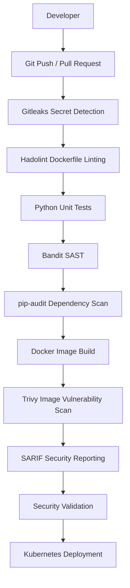

# DevSecOps Policy Pipeline

**A Security-First CI/CD Pipeline for Building, Scanning, and Enforcing Secure Software Deployments**

[]()
[]()
[]()
[]()
[]()

## Overview

DevSecOps Policy Pipeline is a hands-on DevSecOps project designed to demonstrate how security can be integrated throughout the software delivery lifecycle.

The project implements automated security checks at multiple stages, from local development and source-code validation to Docker image scanning and Kubernetes deployment.

Rather than treating security as a final step, this project introduces security gates that identify potentially unsafe configurations, vulnerable dependencies, exposed secrets, and container security issues before deployment.

The long-term objective is to enforce security policies throughout the delivery pipeline so that only compliant workloads can progress toward deployment.

## Project Objectives

- Integrate automated security testing into CI/CD.
- Detect accidentally committed credentials and secrets.
- Identify insecure Dockerfile configurations.
- Detect Python application security issues.
- Audit third-party Python dependencies.
- Scan container images for known vulnerabilities.
- Deploy applications using Kubernetes.
- Introduce Infrastructure as Code security scanning.
- Implement custom security policies using Open Policy Agent.
- Enforce Kubernetes workload security standards.

## Architecture



## Technology Stack

| Category | Tools |
|---|---|
| Application | Python, Flask |
| Containerization | Docker |
| Orchestration | Kubernetes, kind, kubectl |
| CI/CD | GitHub Actions |
| Secret Detection | Gitleaks |
| Dockerfile Linting | Hadolint |
| Static Application Security Testing | Bandit |
| Dependency Auditing | pip-audit |
| Container Security | Trivy |
| Security Reporting | SARIF, GitHub Code Scanning |
| Testing | pytest |
| Local Development | Windows, PowerShell, Docker Desktop |

## Repository Structure

```text
devsecops-policy-pipeline/
│
├── app/
│   └── app.py
│
├── tests/
│   └── test_app.py
│
├── k8s/
│   └── deployment.yaml
│
├── .github/
│   └── workflows/
│       └── security-pipeline.yml
│
├── .pre-commit-config.yaml
├── .dockerignore
├── .gitignore
├── Dockerfile
├── requirements.txt
├── requirements-dev.txt
└── README.md
```

## Implementation Progress

### Phase 1: Foundation and Containerization

**Implemented**

The first phase established the application, container environment, and local Kubernetes deployment.

Implemented components:

- Developed a Flask application with `/` and `/health` endpoints.
- Created a multi-stage Dockerfile.
- Configured a non-root container user.
- Added Docker image build and execution support.
- Created a local Kubernetes environment using kind.
- Configured Kubernetes Deployment and ClusterIP Service.
- Added readiness and liveness probes.
- Configured CPU and memory requests and limits.
- Disabled automatic service account token mounting.
- Applied container security settings, including privilege escalation restrictions and dropped Linux capabilities.

### Phase 2: Shift-Left Security Integration

**Implemented, validation in progress**

The second phase integrates automated security checks into local development and GitHub Actions.

#### Gate 0: Pre-Commit Security Checks

Tools: Gitleaks and Hadolint.

Gitleaks checks staged changes for accidentally exposed credentials and secrets.

Hadolint validates Dockerfile instructions against established Dockerfile best practices.

The objective is to catch common security and configuration issues before changes reach the remote repository.

#### Gate 1: Application and Dependency Security

Tools: Bandit, pip-audit and pytest.

**Bandit**

Performs static application security testing on the Python application.

**pip-audit**

Checks pinned Python dependencies against known vulnerability advisories.

**pytest**

Executes application tests to verify the application's expected behavior.

The dependency audit previously identified a Flask vulnerability, demonstrating that the pipeline can detect vulnerable dependencies and block progression until they are addressed.

#### Gate 2: Container Image Security

Tool: Trivy.

Trivy scans the built Docker image for known vulnerabilities in:

- Operating system packages.
- Python dependencies.
- Container image components.

The configured security threshold is HIGH and CRITICAL severity, with unfixed vulnerabilities excluded from the blocking scan.

The scan is configured to return a failure when qualifying vulnerabilities are detected.

#### Security Reporting

The workflow is designed to generate SARIF security reports and upload them to GitHub Code Scanning when supported by repository permissions and availability.

This provides a way to review security findings alongside the source repository.

## Local Development

### Prerequisites

Install the following tools:

- Python 3.12
- Docker Desktop
- Git
- kubectl
- kind
- Gitleaks
- Hadolint
- pre-commit

### 1. Clone the Repository

```bash
git clone https://github.com/muhammad-ahmadd-shafiq/devsecops-policy-pipeline.git

cd devsecops-policy-pipeline
```

### 2. Create a Python Virtual Environment

Windows PowerShell:

```powershell
python -m venv .venv

.\.venv\Scripts\Activate.ps1
```

### 3. Install Dependencies

```powershell
python -m pip install -r requirements-dev.txt
```

### 4. Run Application Tests

```powershell
python -m pytest -v
```

### 5. Run Bandit

```powershell
python -m pip install bandit==1.8.6

bandit -r app -ll
```

### 6. Run Dependency Audit

```powershell
python -m pip install pip-audit==2.9.0

pip-audit -r requirements.txt
```

### 7. Run Pre-Commit Checks

```powershell
python -m pip install pre-commit

pre-commit install

pre-commit run --all-files
```

Ensure Gitleaks and Hadolint are installed and available in your system PATH.

### 8. Build the Docker Image

```powershell
docker build -t devsecops-policy-pipeline:latest .
```

### 9. Run the Container

```powershell
docker run --rm -d -p 5000:5000 --name policy-pipeline devsecops-policy-pipeline:latest
```

### 10. Test the Application

```powershell
Invoke-RestMethod http://localhost:5000/

Invoke-RestMethod http://localhost:5000/health
```

### 11. Verify Non-Root Execution

```powershell
docker exec policy-pipeline id
```

The container should run under the configured non-root application user.

### 12. Stop the Container

```powershell
docker stop policy-pipeline
```

## Kubernetes Deployment

Create a local Kubernetes cluster:

```powershell
kind create cluster --name policy-lab
```

Load the locally built Docker image:

```powershell
kind load docker-image devsecops-policy-pipeline:latest --name policy-lab
```

Apply the Kubernetes deployment:

```powershell
kubectl apply -f k8s/deployment.yaml
```

Check deployment status:

```powershell
kubectl get deployments
kubectl get pods
kubectl get services
```

Check rollout:

```powershell
kubectl rollout status deployment/devsecops-policy-pipeline
```

Access the application locally:

```powershell
kubectl port-forward service/devsecops-policy-pipeline 8080:80
```

Then visit:

```text
http://localhost:8080
```

Use the service and deployment names defined in the Kubernetes manifest if they differ from these examples.

## CI/CD Workflow

The GitHub Actions workflow is triggered by:

- Pushes to the main branch.
- Pull requests targeting the main branch.
- Manual workflow dispatch.

The pipeline is organized into independent security jobs:

| Job | Purpose |
|---|---|
| Secret Detection | Detect exposed credentials |
| Dockerfile Lint | Identify Dockerfile issues |
| Source Security | Run tests, Bandit and pip-audit |
| Container Security | Build and scan the Docker image |
| Security Reporting | Generate and upload SARIF findings |

The pipeline uses a failure-based security model. Security checks configured as blocking gates prevent successful completion when their defined requirements are not satisfied.

## Security Principles

This project follows several practical DevSecOps principles:

1. **Shift Left Security:** Identify vulnerabilities as early as possible.
2. **Least Privilege:** Run containers with restricted privileges.
3. **Secure Defaults:** Use hardened container and Kubernetes configurations.
4. **Automated Enforcement:** Make security checks part of CI/CD.
5. **Dependency Hygiene:** Audit third-party packages for known vulnerabilities.
6. **Continuous Validation:** Reassess application and container security as changes are introduced.

## Current Project Status

| Phase | Description | Status |
|---|---|---|
| Phase 1 | Application, Docker and Kubernetes foundation | Implemented |
| Phase 2 | Shift-left security and container scanning | Implemented, Trivy validation in progress |
| Phase 3 | Terraform security and custom policy enforcement | Planned |
| Phase 4 | Software supply chain security, SBOM and image signing | Planned |
| Phase 5 | Kubernetes admission control with Kyverno | Planned |
| Phase 6 | Advanced runtime security and monitoring | Planned |
| Phase 7 | Documentation, threat model and final validation | Planned |

**Current validation note:** The Trivy GitHub Actions job is executing the image scan but currently exits with code 1. The vulnerability findings still need to be reviewed and resolved. Phase 2 will be considered fully validated once the configured security gates pass.

## Upcoming Development

### Phase 3: Infrastructure as Code and Policy as Code

- Terraform security scanning with Checkov.
- Custom infrastructure policies using Open Policy Agent.
- Rego policy development.
- Kubernetes manifest validation using Conftest.
- Automated policy enforcement through GitHub Actions.

### Phase 4: Software Supply Chain Security

- Generate Software Bill of Materials using Syft.
- Implement container image signing using Cosign.
- Use GitHub Actions OIDC for keyless signing.
- Verify image signatures and attestations.

### Phase 5: Kubernetes Admission Control

- Introduce Kyverno policies.
- Enforce non-root containers.
- Block privileged workloads.
- Require resource limits.
- Restrict untrusted container registries.
- Validate workloads before admission.

## Learning Outcomes

This project is intended to demonstrate practical experience with:

- DevSecOps pipeline engineering.
- CI/CD security integration.
- Static application security testing.
- Container image vulnerability management.
- Docker security hardening.
- Kubernetes workload security.
- Infrastructure as Code security.
- Policy as Code.
- Software supply chain security.
- Automated security enforcement.

## Author

**Muhammad Ahmad**

BS Information Technology | DevOps and DevSecOps Enthusiast

GitHub: https://github.com/muhammad-ahmadd-shafiq

LinkedIn: https://www.linkedin.com/in/muhammad-ahmad-11b220428/

---

**Project:** DevSecOps Policy Pipeline

**Focus:** Secure Software Delivery | DevSecOps | Cloud Infrastructure | Kubernetes Security | Policy as Code
